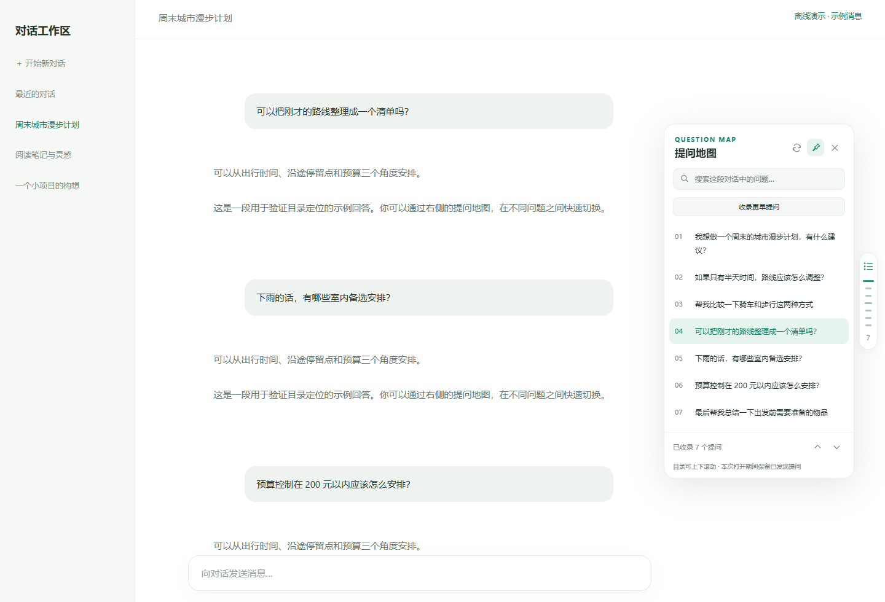

# ChatGPT 提问地图 · Edge 扩展 1.1.0

为当前 ChatGPT 对话增加右侧提问刻度和可搜索目录。无需 API Key，也无需单独登录。

**中文文档：**[完整使用说明](docs/使用说明.md) · [更新日志](CHANGELOG.md) · [测试记录](docs/TESTING.md)

| 功能 | 作用 |
| --- | --- |
| 提问地图 | 在网页右侧用细刻度表示当前对话中的提问位置 |
| 搜索目录 | 输入关键词，点击问题跳转到原文 |
| 历史收录 | 自动向上滚动，收录更早的问题 |
| 临时保留 | 网页卸载早期消息后，地图仍保留已经收录的提问 |
| 阅读定位 | 随网页滚动，高亮正在阅读的问题 |
| 明暗主题 | 跟随网页主题，支持浅色和深色外观 |



示例截图使用模拟消息，不包含私人聊天记录。[深色主题预览](docs/preview-dark.png)。

## 安装（约 1 分钟）

1. 如果下载的是 ZIP，先解压到一个准备长期保留的文件夹。
2. 在 Edge 地址栏输入 `edge://extensions` 并回车。
3. 打开「开发人员模式」。
4. 点击「加载解压缩的扩展」（部分版本显示「加载已解压的扩展」）。
5. 选择解压后的仓库根目录，**该文件夹内应直接看到 manifest.json**。
6. 打开或刷新 https://chatgpt.com 的聊天页面，右侧就会出现绿色地图按钮和细刻度。

安装后请保留扩展文件夹。移动或删除后，需要重新加载。

微软的本地安装说明：https://learn.microsoft.com/en-us/microsoft-edge/extensions/getting-started/extension-sideloading

## 使用

- 悬停右侧地图：临时展开提问目录；移开后收起。
- 点击地图顶部按钮：固定展开，再次点击收起。
- 点击目录里的问题或右侧刻度：跳到对应提问，短暂描边提示。
- 输入关键词：过滤当前对话的问题；Enter 跳到第一个匹配结果。
- 目录可以上下滚动*。
- 「收录更早提问」：自动向上滚动并收录网页逐步加载的早期提问，完成后回到启动前的位置。运行时再次点击可以停止。很长的对话可再次点击，从已经收录的最早位置继续扫描。网页加载较慢时也可稍候重试。
- 已发现的提问会在本次打开期间保留，即使网页随后卸载了它。序号旁的小点表示该提问暂未加载；点击后会尝试滚动到之前的位置，等待网页重新挂载。无法加载时会提示。
- 目录底部上下箭头：跳到上一个／下一个匹配问题。
- 目录中使用方向键移动焦点，Enter 选择。
- `Alt + Shift + M`：展开／收起；在目录中按 Esc 收起。
- 右上角图钉：固定或取消固定目录。
- Edge 工具栏中的扩展图标：可开关整个功能。
- 目录右上角圆形箭头：重新扫描当前对话并清除搜索条件。
- 如果明明有提问却目录为空，打开 Edge 工具栏里的本扩展，点击「查看诊断信息」。可复制其中的结构计数反馈；报告不含提问正文、聊天链接或账号信息。
- 跟随网页明暗主题；网页没有明确主题时，跟随系统。

## 范围与隐私

- 只定位**当前打开的一段对话**中的用户提问，不跨历史对话搜索，也不索引助手回答。
- 读取网页已经加载或在自动向上扫描时新加载的提问。不会调用内部接口，也不能获得网页尚未提供的消息。
- 同一标签页内按对话地址分别缓存已收录提问；切换后返回可恢复目录。**刷新或关闭标签页后缓存清空**。缓存可能保留你刚刚编辑、删除或切换分支前见过的提问；重新加载网页即可重建。
- 刻度最多显示 36 个均匀抽取的位置；展开的目录保留全部已识别问题。
- 空白或只有图片的消息显示图片描述或附件占位标题。
- 扩展不发起外部网络请求、不上传内容、不访问 Cookie 或账号令牌。自动滚动可能触发 ChatGPT 网页自己的历史加载请求。
- 提问正文仅暂存在当前标签页内存，不写入浏览器持久存储。浏览器扩展本地存储仅保存启用、固定两项偏好。
- 仅在 `https://chatgpt.com/*` 和旧域名 `https://chat.openai.com/*` 上运行。
- 使用 Manifest V3，仅申请 `storage` 权限；没有后台进程、外部库或分析统计。

## 更新与故障排查

修改文件后，在 `edge://extensions` 找到本扩展并点重新加载，再刷新 ChatGPT 网页。

从 1.0.x 更新：把新版本解压到原来加载的扩展目录，覆盖原文件（包括新增的 history.js）；然后在扩展管理页重新加载，并刷新已有聊天网页。若准备换一个安装目录，可先移除旧扩展，再加载新的 `chatgpt-question-map` 文件夹。扩展菜单顶部应显示版本 1.1.0。

1.1.0 更新：在当前标签页内按对话保留已发现的提问；新增自动向上扫描更早提问及停止操作；尝试重新加载已卸载提问以定位；提高目录可视高度；工具栏区分已收录数量与网页当前加载数量。已用仅挂载 7 条、总计 42 条的虚拟列表验证收录、重复提问保留与历史定位，并保留 120 条目录测试。

1.0.2 修复：根据用户提供的真实页面标签，新增 `data-user-message-bubble="true"` 提问气泡识别，不再要求页面存在 article 或旧版轮次/角色标记。新旧标记同时出现时只保留一条提问；支持气泡标记延迟添加；诊断报告新增 bubbleMarkers 计数。

1.0.1 修复：兼容提问外层使用 `display: contents` 的布局；同时识别用户角色、用户轮次、用户消息测试标记及隐藏的发言者标题；跳转使用真实占据布局的消息元素，并让浏览器展开嵌套滚动区域；在消息由隐藏变为可见时重新扫描。

若没有刻度：确认功能已启用、网页刷新过，并且当前对话里有已发送的用户消息。旧域名会按网站自身规则跳转。

ChatGPT 网页结构可能变化。目前通过 `data-user-message-bubble="true"`、`data-message-author-role="user"`、`data-turn="user"`、`data-testid="user-message"` 及特定隐藏发言者标题识别提问。未来页面结构改变可能需要更新选择器。1.0.2 已使用用户提供的气泡结构验证，尚未直接访问用户已登录的页面。

这是独立制作的本地扩展，与 OpenAI、Microsoft、DeepSeek 无隶属关系。安装包未发布到扩展商店。

## 文件

- `manifest.json`：扩展声明和运行域名。
- `content.js`：目录、提问识别、跳转与主题适配。
- `history.js`：按顺序合并已加载和已收录提问。
- `popup.html` / `popup.css` / `popup.js`：工具栏菜单。
- `icons/`：扩展图标。

测试记录见 [docs/TESTING.md](docs/TESTING.md)。截图为模拟消息的离线演示，自动测试未访问已登录的真实 ChatGPT 对话。

## 开发与验证

扩展本身无需安装依赖或执行构建。若要运行自动检查，需要 Node.js 20 或更高版本：

```sh
npm run check
npm install
npm test
```

测试在 Windows 默认使用已安装的 Edge；其他平台默认使用 Playwright Chromium（先运行 `npx playwright install chromium`）。也可通过 `TEST_BROWSER_EXECUTABLE` 指定浏览器可执行文件。

测试使用隔离浏览器配置，所有测试文件和截图写入仓库内的 `work/`，已被 Git 忽略。测试拦截 chatgpt.com 并返回离线模拟对话，不读取个人账号。浏览器没有成功加载扩展时会回退为直接注入相同脚本，并在报告中标明。
